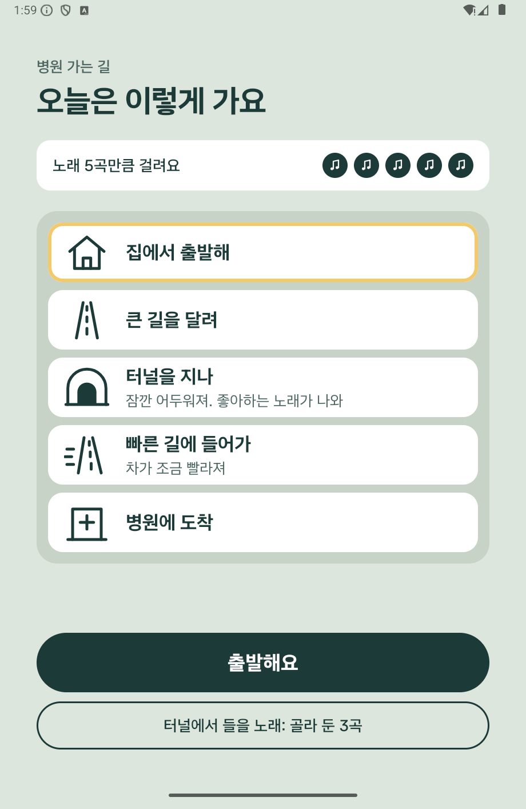
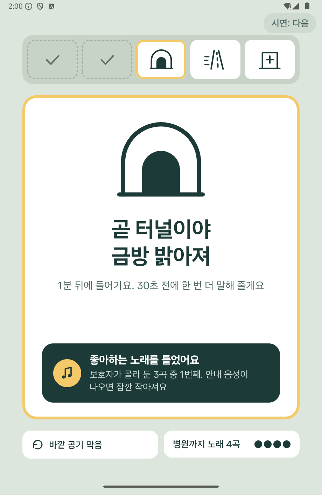
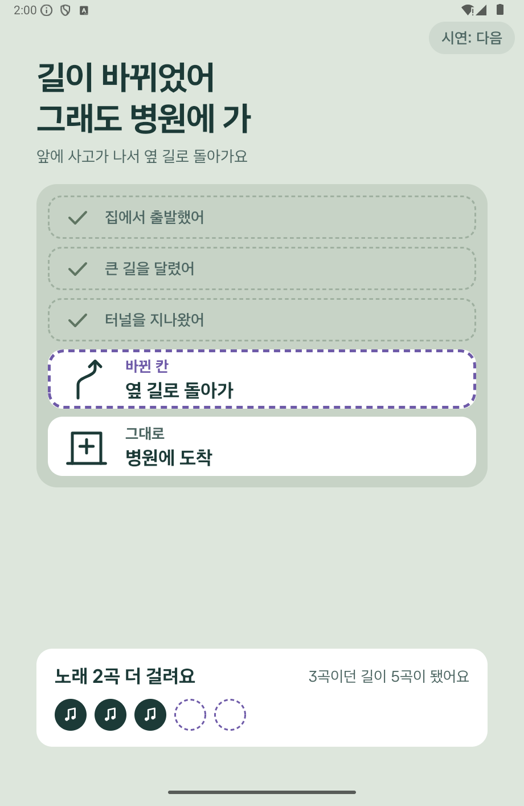
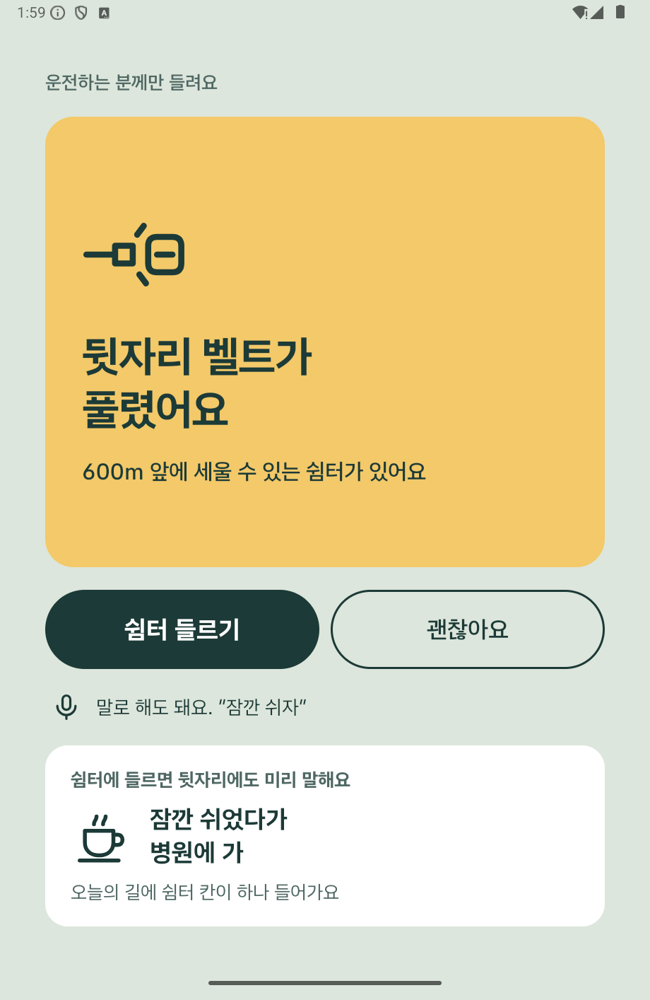
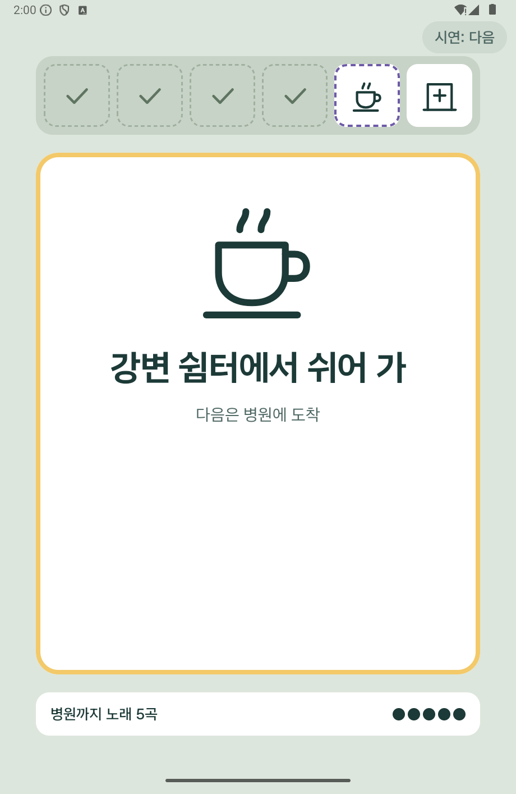
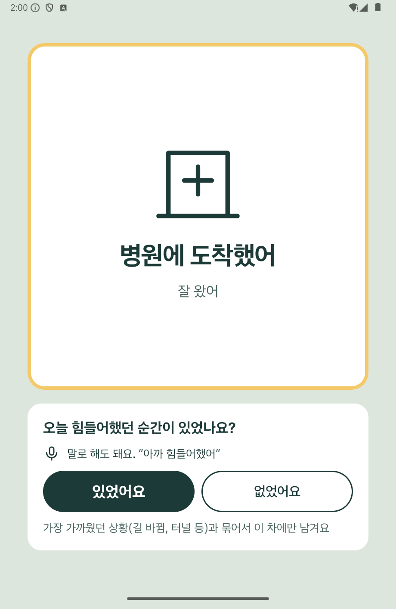
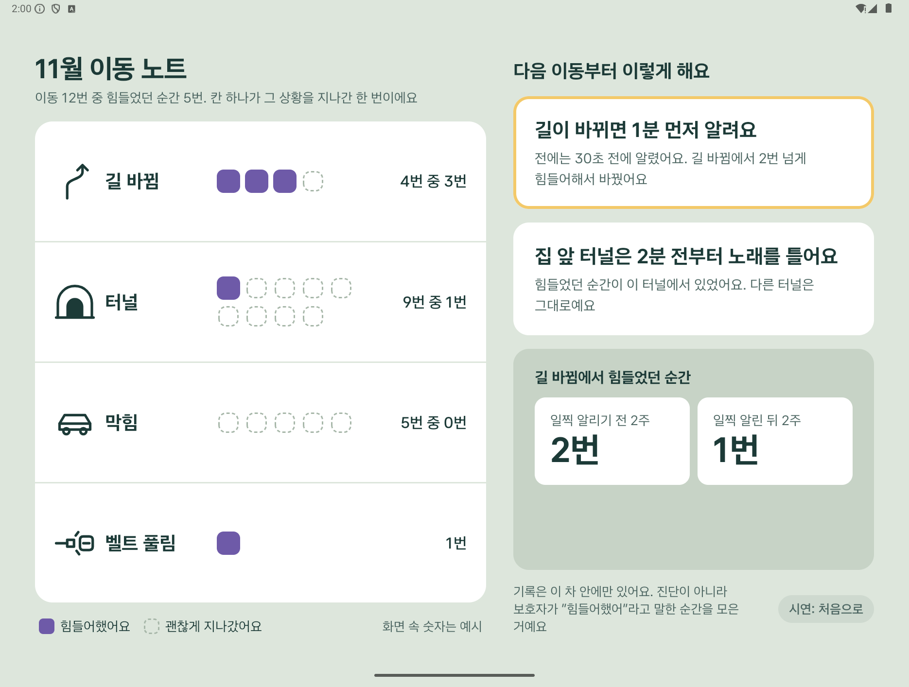

<div align="center">

# 다음은요 (가칭)

**발달장애가 있는 동승자에게, 다음에 무슨 일이 생기는지 차가 먼저 쉬운 말로 알려 준다**

운전하는 보호자는 운전에만 집중하고, 뒷자리는 놀라지 않게.


[APK 받기](apk/봇듀_다음은요_release.apk) · [개발일지](docs/개발일지.md) · [시연 방법](#실행)

</div>

> [!NOTE]
> 2026 현대자동차그룹 차량용 앱 개발 공모전 "Code your App into Pleos App Market" 출품작, 팀 봇듀.
> 차량 신호는 아직 시연용 시나리오(병원 가는 길)로 재생한다. Pleos SDK 연결은 [현재 상태](#현재-상태)에 적었다.

## 왜 만들었나

자폐 특성이 있는 사람에게 예상하지 못한 변화는 큰 불안의 원인이다. 그래서 그림 일정표와 "5분, 2분, 1분" 단계 예고가 널리 쓰인다.
그런데 차 안의 변화(길이 바뀜, 막힘, 터널, 빠른 길 진입)는 출발 전에 손으로 만든 일정표에 없다.
그 변화를 가장 먼저 아는 것은 차의 내비다. 다음은요는 그 신호를 받아 동승자 눈높이의 말과 그림으로 바꾼다.

| 근거 | 출처 |
| --- | --- |
| 등록 발달장애인 약 27만 명 (지적 229,780명, 자폐성 42,744명) | 보건복지부 2023 등록장애인 통계 (한국장애인개발원 디딤돌) |
| 도전적 행동이 잦을수록 보호자 돌봄 부담이 커진다 | 발달장애인 실태조사 분석 연구들 |
| 전환 지원: 그림 일정표, 시각 타이머, 단계 예고 | Indiana University 전환 지원 자료 |

## 기능

| 기능 | 무엇을 하나 | 쓰는 신호 |
| --- | --- | --- |
| **오늘의 길 카드** | 내비 경로를 3~5칸 그림 카드로 줄인다. 처음·끝은 늘 남기고 가운데는 터널 > 빠른 길·쉼터 > 큰 길 순으로. 남은 시간은 "노래 n곡" | NaviHelper 경로·TBT |
| **변화 미리 알리기** | 길이 바뀌면 "길이 바뀌었어. 그래도 병원에 가"처럼 **목적지가 그대로라는 말부터**. 바뀐 칸만 보라색 점선, 늘어난 시간은 "노래 2곡 더" | NaviHelper onReRouteEnded, 남은 시간 |
| **터널 전 좋아하는 노래** | 터널 1분 전에 보호자가 골라 둔 노래를 앱이 직접 틀고 내기순환을 켠다. 30초 전에 한 번 더, 빠져나오면 "다 지나왔어" 하고 원래대로 | onTBTInfo(TURN_TUNNEL)·차속, HVAC |
| **보호자 안심 신호** | 달리는 중 뒷자리 벨트가 풀리거나 문·창문이 열리면 **운전자에게만** 한 줄로. "잠깐 쉬자"라고 하면 쉼터를 경유지로 넣고 뒷자리에도 미리 말한다 | Vehicle Safety·Door·Window, STT |
| **힘들었던 순간 기억** | 보호자가 "힘들어했어"라고 말하면 5분 안 가장 가까운 상황(길 바뀜·터널·막힘·벨트)에 묶어 둔다. 그 터널은 2분 전부터, 길 바뀜이 2번 넘게 힘들면 꺾기 예고를 1분 전으로 | STT, 위 신호들 |

하지 않는 것: 진단, 행동 교정, 약효·상태 추정. 기록은 보호자가 말한 순간뿐이고 차 밖으로 나가지 않는다.

## 화면

| 출발 전 | 터널 1분 전 | 길이 바뀌었을 때 |
| --- | --- | --- |
|  |  |  |
| **보호자 안심 신호** | **쉼터 칸이 들어감** | **도착** |
|  |  |  |

**이동 노트 (주차 중, 가로 2칸)** — 화면 속 숫자는 예시



### 디자인

특수교육에서 쓰는 "그림 일정표 띠"에서 가져왔다. 세이지색 펠트 바탕(#DDE6DC)에 흰 그림 카드, 지난 칸은 점선으로 접힌다.
강조는 두 가지뿐: 겨자색(#F3C969) = 지금 칸, 보라색 점선(#6E5AA8) = 바뀐 칸. 경고에도 빨강을 쓰지 않는다 (뒷자리 동승자가 화면을 봐도 놀라지 않게).
서체는 Asta Sans(42dot, OFL) — 현대차 광고의 Hyundai Sans는 배포할 수 없는 전용 서체라 팀 출품작 공통으로 쓴다. 그림은 굵은 선 하나로 직접 그렸다(`ui/Picto.kt`).

## 시스템 구조

```
NaviHelper (경로·TBT·재탐색)  ┐
Vehicle (Safety·Door·Window)  ├─▶ engine/ (화면과 분리, 단위 테스트 23개) ─▶ ui/ (Compose)
STT (보호자 말)               ┘     RouteCardBuilder · ChangeAnnouncer      ─▶ car/ (TTS·노래·공조)
                                    TunnelCue · GuardianWatch · MomentLog · LeadPolicy
```

- `engine/`는 안드로이드에 의존하지 않는 순수 Kotlin이다. 신호를 넣으면 "무슨 말을 할지, 어느 칸을 바꿀지, 노래·공조를 켤지(CueAction)"만 돌려준다
- `car/`가 그 일을 실제로 한다. 지금은 안드로이드 TTS·MediaPlayer, 공조는 화면 표시. Pleos 차량에서는 Pleos TTS, HVAC 제어로 바꿔 끼운다
- 터널 노래는 오디오 포커스를 잠깐 빌린다(`AUDIOFOCUS_GAIN_TRANSIENT`, USAGE_MEDIA). 내비 안내가 나오면 차가 노래 소리를 줄이고, 끝나면 원래 듣던 소리로 돌아간다
- 기본 노래 `res/raw/calm_song.wav`는 저작권 문제가 없도록 직접 합성했다 (`tools/make_calm_song.py`, 느린 5음계 58초)

## 실행

```bash
./gradlew testDebugUnitTest   # 엔진 테스트 23개
./gradlew assembleRelease     # apk: app/build/outputs/apk/release
```

앱을 켜면 출발 전 화면. "출발해요" 뒤로는 오른쪽 위 **시연: 다음** 버튼이 SDK 콜백을 대신해 장면을 넘긴다:
큰 길 → 터널 1분 전(노래·내기순환) → 30초 전 → 터널 통과 → 길 바뀜 → 뒷자리 벨트 → 쉼터 → 도착 → 이동 노트.

장면 바로 열기 (캡처용, 소리 끔):

```bash
adb shell am start -n com.botdue.daeum/.MainActivity --es step TUNNEL_FIRST --ez quiet true
# step: START ROAD TUNNEL_FIRST TUNNEL_SECOND TUNNEL_PASSED REROUTE BELT REST ARRIVED NOTES
```

## 현재 상태

- [x] 판정 엔진 + 단위 테스트 23개 (길 카드, 길 바뀜 문장, 터널 단계 예고, 보호자 알림·말 알아듣기, 힘든 순간 묶기, 예고 앞당기기)
- [x] 화면 6종 + 시연 시나리오, 터널 노래 실제 재생·오디오 포커스 확인 (휴대폰 에뮬레이터)
- [ ] Pleos Connect 에뮬레이터에서 NaviHelper·Vehicle 콜백 실제 연결 (`PleosSignalSource`)
- [ ] SDK 확인: 안전벨트를 좌석별로 구분해 받을 수 있는지, 앰비언트 라이트 제어, TBT로 터널 길이·끝 지점
- [ ] 보호자 "힘들어했어" STT 연결 (지금은 도착 화면 버튼)
